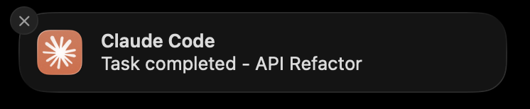
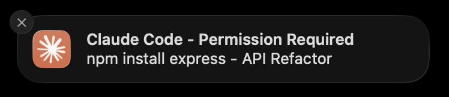

# Claude Code Notify

Native macOS notifications for [Claude Code](https://github.com/anthropics/claude-code) CLI.

Get notified when Claude completes a task or needs your permission - instantly!

| Task Completed | Permission Required |
|:-:|:-:|
|  |  |

## Features

- **Instant notifications** - No delay thanks to PreToolUse hook
- **Smart permission detection** - Only notifies when permission is actually needed
- **Native macOS notifications** - No dependencies
- **Warp tab name support** - Shows which tab the notification came from (e.g., `Task completed - API Refactor`)
- **Customizable sounds**
- **Works with all terminals** (Warp, iTerm2, Terminal.app, VS Code, etc.)
- **Stays quiet inside [Ghostex](https://github.com/maddada/Ghostex)** - Ghostex sends its own notifications, so you never get two
- **On/off switch** - `CLAUDE_NOTIFY=off` or `on` for one session, a project, a terminal app or everywhere
- **One-line installation** with automatic configuration

## Requirements

- macOS 12.0 or later
- Xcode Command Line Tools (`xcode-select --install`)
- Claude Code CLI

## Installation

**One-line install** (recommended):

```bash
curl -fsSL https://raw.githubusercontent.com/suatkocar/claude-code-notify/main/install.sh | bash
```

This will:
1. Download and compile the notification app
2. Configure hooks in `~/.claude/settings.json` automatically
3. Request notification permission

**Manual install**:

```bash
git clone https://github.com/suatkocar/claude-code-notify.git
cd claude-code-notify
./install.sh
```

## Configuration

The installer adds these hooks to `~/.claude/settings.json`, next to the hooks you already have (it keeps them, replaces only its own earlier entries, and saves a backup as `settings.json.claude-notify.bak` first):

```json
{
  "hooks": {
    "Stop": [
      {
        "hooks": [
          {
            "type": "command",
            "command": "~/.claude/notify.sh"
          }
        ]
      }
    ],
    "Notification": [
      {
        "hooks": [
          {
            "type": "command",
            "command": "~/.claude/notify.sh"
          }
        ]
      }
    ],
    "PreToolUse": [
      {
        "matcher": "Bash|Write|Edit",
        "hooks": [
          {
            "type": "command",
            "command": "~/.claude/notify-permission.sh"
          }
        ]
      }
    ]
  }
}
```

## How It Works

1. **Stop Hook**: Notifies when Claude finishes a response, with the start of its last message
2. **Notification Hook**: Notifies when Claude is waiting for your input
3. **PreToolUse Hook**: Notifies when Claude needs permission to run a command

### Smart Permission Detection

The `notify-permission.sh` script reads your `permissions.allow` list from `settings.json` and only sends notifications when:
- The tool actually requires permission (not in your allowed list)
- Shows the command/file path in the notification

**Notification format:**
- **Title:** `Claude Code - Permission Required`
- **Body:** `command - Tab Name` (e.g., `npm install - API Refactor`)
- For Edit/Write: Shows the file path (e.g., `Edit: /path/to/file.js - My Project`)

## Inside Ghostex

[Ghostex](https://github.com/maddada/Ghostex) shows its own notification and plays its own sound when a session finishes or needs you. Inside a Ghostex session these scripts stay quiet, so you get one notification instead of two. They check the same variables Ghostex's own hook checks (`GHOSTEX_GLOBAL_SESSION_REF` and `GHOSTEX_GXSERVER_BASE_URL`), so they go quiet exactly where Ghostex takes over. Every other terminal is unaffected.

## Turning Notifications Off or On

Set `CLAUDE_NOTIFY` to `off` to silence the notifications, or to `on` to force them (for example inside Ghostex). Left unset, the automatic behavior above applies.

| To silence | Where | What to write |
|---|---|---|
| One Claude session | The terminal, when you start it | `CLAUDE_NOTIFY=off claude` |
| A background job or script | The command that starts it | `CLAUDE_NOTIFY=off claude -p "..."` |
| One terminal app (e.g. Warp) | `~/.zshrc` | `[[ $TERM_PROGRAM == WarpTerminal ]] && export CLAUDE_NOTIFY=off` |
| One project | That project's `.claude/settings.local.json` | `{ "env": { "CLAUDE_NOTIFY": "off" } }` |
| Everywhere | `~/.claude/settings.json` | `"env": { "CLAUDE_NOTIFY": "off" }` |

To get Claude Code Notify's notifications inside Ghostex as well, start that session with `CLAUDE_NOTIFY=on claude`.

## Customization

### Change Notification Sound

Available sounds: `Basso`, `Blow`, `Bottle`, `Frog`, `Funk`, `Glass`, `Hero`, `Morse`, `Ping`, `Pop`, `Purr`, `Sosumi`, `Submarine`, `Tink`

Change `SOUND="Glass"` in `~/.claude/notify.sh` to use another sound.

## Troubleshooting

### Notifications not showing?

1. Check System Settings > Notifications > Claude Code
2. Make sure "Allow Notifications" is enabled
3. Set alert style to "Banners" or "Alerts"

### Permission denied?

```bash
chmod +x ~/.claude/notify.sh
chmod +x ~/.claude/notify-permission.sh
codesign --force --deep --sign - ~/.claude/ClaudeNotify.app
```

## Uninstall

```bash
rm -rf ~/.claude/ClaudeNotify.app
rm ~/.claude/notify.sh
rm ~/.claude/notify-permission.sh
```

Remove the `Stop`, `Notification` and `PreToolUse` entries that run `notify.sh` or `notify-permission.sh` from `~/.claude/settings.json`.

## License

MIT
